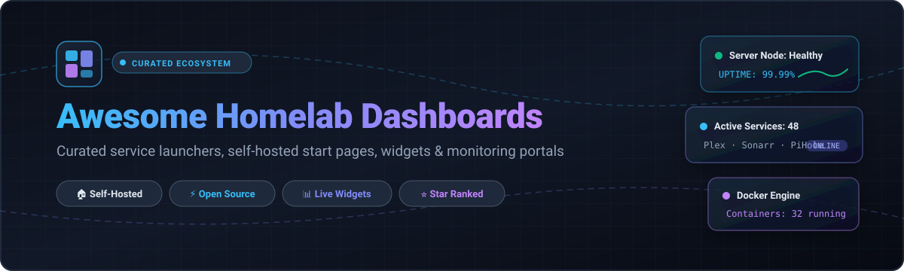

# 🚀 Awesome Homelab Dashboards 🎛️

### Curated Collection of Service Launchers, Live Status Widgets & Self-Hosted Start Pages

  
  
  
  
  
  
  

  <em>A directory of top open-source dashboards, self-hosted service bookmarkers, dynamic infrastructure status panels, and PaaS deployment environments for homelab enthusiasts and sysadmins.</em>

---

## 📖 Overview

Welcome to **Awesome Homelab Dashboards**! 🏠 Whenever you manage a self-hosted infrastructure or home server environment, scattered browser bookmarks, forgotten ports, and IP addresses become difficult to track. A homelab dashboard acts as a single pane of glass and personal control center—unifying your Docker containers, media centers, download clients, network monitors, and services under one fast, aesthetic web interface.

This curated list features battle-tested open-source projects, customizable start pages, and cloud hosting alternatives with real-time GitHub popularity tracking, feature trade-offs, and pricing transparency.

---

## 📑 Table of Contents

- [📈 Sector Overview & Market Dynamics](#-sector-overview--market-dynamics)
- [☁️ SaaS & Hosted Platforms](#️-saas--hosted-platforms)
- [🌟 Open-Source GitHub Projects](#-open-source-github-projects)
- [🤝 How to Contribute](#-how-to-contribute)
- [💖 Support](#-support)
- [📊 Star History](#-star-history)
- [⚖️ Disclaimer](#️-disclaimer)

---

## 📈 Sector Overview & Market Dynamics

The broader cloud Platform-as-a-Service (PaaS) and developer hosting market is valued at approximately **$90B–$140B** (projected to exceed $350B by 2030 at ~18–20% CAGR), while specialized managed open-source homelab/app hosting represents a rapidly growing sub-niche of several hundred million dollars. The sector is **moderately fragmented**: core cloud compute is anchored by hyper-scalers (AWS, Azure, GCP), but the application-layer deployment and self-hosted tooling space exhibits a competitive, highly fragmented ecosystem of specialized PaaS providers and managed container hosts.

---

## ☁️ SaaS & Hosted Platforms

While homelab dashboards are fundamentally designed to run on local private networks to connect to local devices and containers, several managed cloud hosting platforms and specialized SaaS solutions provide turn-key environments for deploying and monitoring homelab dashboards without local bare-metal hardware.

| Platform | Starting Pricing | Free Tier / Trial Limits | Company Size (Valuation / Revenue) | Description |
| :--- | :--- | :--- | :--- | :--- |
| **[Render](https://render.com)** | $7/month (Starter compute tier; Pro workspace at $25/month) | 750 free instance hours/month; web services spin down after 15 minutes of inactivity; free PostgreSQL expires after 30 days (1 GB cap) | ~$1.5B Valuation ($27M ARR run-rate) | Unified cloud application platform offering Git-automated builds, persistent services, and managed databases to run containerized dashboards. |
| **[Railway](https://railway.com)** | $5/month (Hobby plan base price, includes $5 usage credits) | 30-day free trial ($5 one-time credit, capped at 2 vCPU / 1 GB RAM / 0.5 GB volume); reverts to $1/month usage credit free tier (0.5 GB RAM, 1 vCPU) | ~$500M–$1B Est. Valuation (~$10M–$30M ARR, $120M raised) | Cloud infrastructure orchestration platform enabling 1-click template and repository deployments for homelab startpages and utility apps. |
| **[Netdata Cloud](https://www.netdata.cloud)** | $4.50/node/month (billed annually) or $90/year Homelab plan | Free Forever Community plan for up to 5 active nodes; unlimited per-second metrics and real-time interactive monitoring dashboards | ~$68M–$85M Est. Valuation (~$6M–$7M ARR, $35M raised) | Cloud-managed telemetry, system health, and infrastructure dashboard platform connecting distributed homelab servers and containers. |
| **[Elestio](https://elest.io)** | $11/month (billed hourly based on smallest VM size) | 3-day free trial with $20 credit (limited to deploying and testing up to 2 active services) | ~$550K ARR (Bootstrapped, no external institutional valuation) | Fully-managed DevOps hosting platform that deploys open-source homelab software onto dedicated cloud VMs with automated backups, SSL, and full root access. |
| **[PikaPods](https://www.pikapods.com)** | ~$1.80/month (metered hourly based on minimum CPU/RAM/storage pod allocation) | $5 welcome credit on signup (no credit card required, sufficient to run minimal pods for ~2-3 months); no permanent free-for-life tier | ~$200K–$500K Est. ARR (Bootstrapped via Peakford Ltd, no external institutional valuation) | Specialized managed 1-click container hosting service tailored for lightweight open-source homelab applications, bookmark tools, and utilities. |

---

## 🌟 Open-Source GitHub Projects

The premier open-source dashboards and self-hosted service panels, ranked in descending order by GitHub stargazers:

### 1. **[Uptime Kuma](https://github.com/louislam/uptime-kuma)** 
- **Focus**: Self-hosted uptime monitoring & status pages.
- **Overview**: A fancy self-hosted monitoring tool featuring real-time uptime pinging (HTTP/HTTPS, TCP, Ping, DNS, Docker container), multi-language UI, rich notification integrations (Telegram, Discord, Slack, Gotify, Webhooks), and public status pages.
- **Trade-offs**: Built for status checks and incident alerts rather than general application launcher grids.
- **Best for**: Homelabbers needing a reliable, self-hosted service monitor and public/private status page.

### 2. **[Portainer](https://github.com/portainer/portainer)** 
- **Focus**: Container management and orchestrator dashboard.
- **Overview**: The universal graphical container dashboard for Docker, Docker Swarm, and Kubernetes environments. Inspect container health, manage volumes, trigger redeployments, and view container logs from a web browser.
- **Trade-offs**: Focuses on DevOps and container lifecycle management rather than serving as a daily bookmark launcher.
- **Best for**: Server admins managing multi-container Docker stacks and home clusters.

### 3. **[Glance](https://github.com/glanceapp/glance)** 
- **Focus**: Feed-first start page & morning brief dashboard.
- **Overview**: An all-in-one lightweight dashboard designed to aggregate RSS feeds, Reddit posts, YouTube subscriptions, weather, stock tickers, and server bookmarks into a sleek single feed.
- **Trade-offs**: Less oriented toward deep media automation (*arr suite) queries.
- **Best for**: Users looking for an informative, aesthetic new-tab dashboard and daily overview.

### 4. **[Homepage](https://github.com/gethomepage/homepage)** 
- **Focus**: Fast, secure, and deeply integrated live service dashboard.
- **Overview**: YAML-configured modern application dashboard with 100+ native service widgets (Docker, Plex, Jellyfin, Sonarr, Radarr, qBittorrent, Pi-hole, AdGuard Home). Server-side rendered with instant search, automatic localization, and custom info widgets.
- **Trade-offs**: Requires configuration via YAML files (no visual drag-and-drop web editor).
- **Best for**: Homelab power users running 5+ services who want deep API telemetry without UI lag.

### 5. **[Dashy](https://github.com/lissy93/dashy)** 
- **Focus**: The feature-maximalist and highly customizable dashboard.
- **Overview**: Supports dozens of themes, multi-page layouts, animations, status checks, keyboard shortcuts, multiple search providers, and integrated authentication. Configurable either via web UI or YAML.
- **Trade-offs**: Can feel complex for simple setups; client-side Vue rendering can be heavier than lightweight alternatives.
- **Best for**: Enthusiasts who want complete visual freedom and rich custom CSS/widget layouts.

### 6. **[Beszel](https://github.com/henrygd/beszel)** 
- **Focus**: Lightweight homelab server hardware monitoring dashboard.
- **Overview**: A streamlined, modern server monitoring dashboard paired with lightweight agents to track CPU, memory, disk, network, temperature, and container metrics with historical charts and alerts.
- **Trade-offs**: Specifically focused on metrics and system stats rather than application navigation tiles.
- **Best for**: Multi-node homelab telemetry without the overhead and complexity of Prometheus/Grafana.

### 7. **[Homer](https://github.com/bastienwirtz/homer)** 
- **Focus**: Simple, static, lightweight YAML-driven startpage.
- **Overview**: A dead-simple static service bookmark launcher configured with a single `config.yml` file. Has zero backend dependencies and virtually zero memory footprint (runs smoothly even on a Raspberry Pi Zero).
- **Trade-offs**: Purely static links; no live polling widgets or dynamic service status checks.
- **Best for**: Minimalists who value instant rendering and effortless single-file backups.

### 8. **[Heimdall](https://github.com/linuxserver/Heimdall)** 
- **Focus**: Beginner-friendly drag-and-drop web launcher.
- **Overview**: The classic homelab application dashboard. Provides a clean web GUI to add links, pre-styled application tiles with auto-discovered icons, and enhanced apps displaying basic live notifications (e.g., torrent download counts).
- **Trade-offs**: Heavier PHP/Laravel framework; less flexible layout options compared to modern widget-based alternatives.
- **Best for**: Beginners who want a dashboard up and running in under 5 minutes without touching terminal configs.

### 9. **[Dashboard Icons](https://github.com/homarr-labs/dashboard-icons)** 
- **Focus**: Dedicated icon repository for homelab dashboards.
- **Overview**: A curated, high-resolution collection of SVG/PNG icons designed specifically for homelab dashboards (Homarr, Homepage, Dashy, Flame, Heimdall) covering popular self-hosted software and cloud services.
- **Trade-offs**: Icon asset repository rather than a standalone dashboard interface.
- **Best for**: Polishing your custom dashboard interface with matching vector artwork.

### 10. **[Flame](https://github.com/pawelmalak/flame)** 
- **Focus**: Minimalist start page with Docker auto-discovery.
- **Overview**: Fast, clean start page with a built-in search bar, weather widget, and bookmark grouping. Features automatic app discovery via Docker container labels and a built-in GUI editor.
- **Trade-offs**: Limited widget library; maintenance pace has slowed.
- **Best for**: Users looking for a fast, uncluttered browser homepage and quick launcher.

### 11. **[Organizr](https://github.com/causefx/Organizr)** 
- **Focus**: Tabbed HTPC & homelab service organizer.
- **Overview**: Allows you to embed your existing homelab and media applications (Plex, Sonarr, Radarr, transmission) into single-tab or multi-tab iFrames with custom user access controls and authentication.
- **Trade-offs**: Relies on iFrames (which some modern web apps block via CSP headers unless configured).
- **Best for**: Media-centric home theaters wanting a unified single-window management interface.

### 12. **[Homarr](https://github.com/homarr-labs/homarr)** 
- **Focus**: Modular homelab dashboard with deep media automation integrations.
- **Overview**: Modern dashboard with drag-and-drop customization, multi-user authentication (OIDC/LDAP), Docker management, and direct integration with the Plex/*arr stack (Sonarr, Radarr, Lidarr, Deluge, Transmission).
- **Trade-offs**: Higher resource consumption than static YAML alternatives; larger footprint.
- **Best for**: Homelabbers who treat their dashboard as an active media and download control center.

### 13. **[Stackyard](https://github.com/SandObserver/Stackyard)** 
- **Focus**: Calm, badge-centric dashboard with zero heavy charts.
- **Overview**: A calm dashboard with zero dependencies where service status badges only appear when something requires attention, keeping your home start page quiet and purposeful.
- **Trade-offs**: Smaller community and minimal widget library.
- **Best for**: Users seeking a distraction-free status overview.

---

## 🤝 How to Contribute

Contributions are warmly welcome! 🎉 If you would like to add a new project, dashboard tool, or update existing details:

1. 🍴 **Fork the repo**.
2. 🌿 **Create a new branch** (`git checkout -b feature/new-dashboard`).
3. 📝 **Add/edit entries** in `README.md` following the existing format (include repo link, star badge, focus, description, and trade-offs).
4. 🚀 **Submit a Pull Request** with a concise description of your changes.

---

## 💖 Support

If you found **Awesome Homelab Dashboards** helpful for your server setup, please consider supporting the project!

- ⭐ **Star this repository** to help others discover it!
- 🍴 **Fork and share** it with fellow homelabbers on Reddit (`r/homelab`, `r/selfhosted`) and Discord!
- ☕ **Buy me a coffee / Sponsor**: If you'd like to support ongoing curation and maintenance, visit the [**Sponsor Dashboard**](https://github.com/sponsors/ishandutta2007) 💖.

---

## 📊 Star History

---

## ⚖️ Disclaimer

- This list is a **community-curated** resource compiled for educational and organizational purposes—it does not constitute an endorsement.
- **SaaS vs Self-Hosted**: Homelab dashboards are inherently self-hosted software intended for private local networks; hosted PaaS providers (Render, Railway, PikaPods) provide convenience wrappers for running containerized instances.
- **Security Notice**: Always configure robust authentication (such as SSO, Authelia, or Cloudflare Tunnels) before exposing any local homelab dashboard to the public internet.
